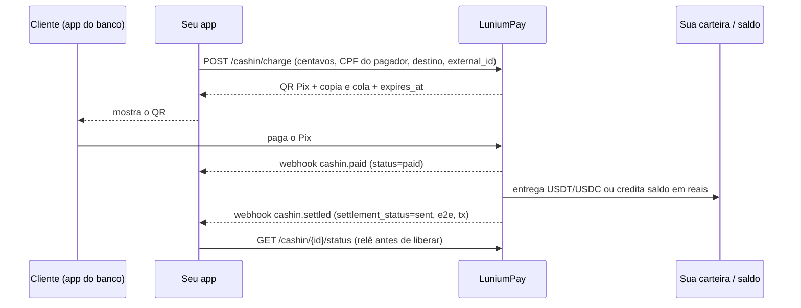

<p align="center">
  <strong style="font-size:1.4em">LuniumPay</strong><br/>
  <em>Pix ⇄ stablecoin no Brasil, por API.</em><br/>
  Seu cliente paga um Pix normal. Você recebe USDT/USDC na sua carteira, ou saldo em reais para sacar em cripto quando quiser. Cripto → Pix com comprovante do Banco Central. Chave de produção em uma chamada.
</p>

<p align="center">
  <a href="https://docs.luniumpay.com/openapi.json"></a>
  <a href="https://github.com/LuniumPay/lunium-agent-skills/releases"></a>
  <a href="https://registry.modelcontextprotocol.io/v0.1/servers?search=lunium"></a>
  <a href="https://docs.luniumpay.com/status"></a>
  <a href="https://github.com/LuniumPay/lunium-agent-skills/blob/main/LICENSE"></a>
</p>

---

## Teste agora, sem conta e sem dinheiro (60 segundos)

```bash
# 1. chave de SANDBOX (o e-mail recebe o manual uma única vez)
curl -s -X POST https://api.luniumpay.com/keys/sandbox -H 'Content-Type: application/json' \
  -d '{"email":"voce@empresa.com"}'
# → {"api_key":"lun_test_…", ...}   guarde em LUNIUM_API_KEY

# 2. cobrança Pix de R$ 100,00 com entrega em USDT na sua carteira
curl -s -X POST https://api.luniumpay.com/cashin/charge -H "X-API-Key: $LUNIUM_API_KEY" -H 'Content-Type: application/json' \
  -d '{"amount_cents":10000,"payer_tax_number":"12345678909","destino":"cripto","asset":"USDT","chain":"polygon","payout_address":"0x000000000000000000000000000000000000dEaD","external_id":"pedido-1","sandbox_scenario":"success"}'
# → cashin_id, qr_image_url, qr_copypaste, expires_at

# 3. simule o pagamento (só no sandbox) e leia o estado final
curl -s -X POST https://api.luniumpay.com/sandbox/cashin/$CASHIN_ID/pay -H "X-API-Key: $LUNIUM_API_KEY" -H 'Content-Type: application/json' -d '{}'
curl -s https://api.luniumpay.com/cashin/$CASHIN_ID/status -H "X-API-Key: $LUNIUM_API_KEY"
# → status: paid · settlement_status: sent · usdt_amount · e2e · settlement_tx_hash
```

Gostou? Chave de produção na hora, sem aprovação humana, mesmo contrato:

```bash
curl -s -X POST https://api.luniumpay.com/keys -H 'Content-Type: application/json' -d '{"name":"Minha Empresa","email":"voce@empresa.com"}'
```

## Programa com IA? Um comando

```bash
npx skills add LuniumPay/lunium-agent-skills
```

Depois peça ao Claude Code, Cursor, Codex ou Gemini CLI: *"quero receber Pix e cair em USDT na minha carteira"*. O agente cria a chave, escreve o backend na sua stack (Next.js, Express, FastAPI, Supabase), mostra o QR exatamente como a API devolve, configura o webhook assinado e prova tudo no sandbox. Ou deixe o script montar: `node luniumpay/scripts/init.mjs --email voce@empresa.com`. No Claude Code: `/plugin marketplace add LuniumPay/lunium-agent-skills`.

## Como o dinheiro anda



Três eixos independentes no status: `status` (o Pix), `settlement_status` (a entrega) e `settlement_proof` (a evidência). Libere o pedido com `paid` **e** `sent`.

## O que você consegue fazer

| Produto | Em uma linha | Núcleo |
|---|---|---|
| **Receber Pix → cripto** | Cliente paga Pix; você recebe USDT/USDC (ou outro ativo do catálogo) na carteira, em dezenas de redes | `POST /cashin/charge` destino `cripto` |
| **Receber Pix → saldo** | Saldo em reais sem carteira fixa, subcontas por cliente, saque em cripto sem teto comercial por valor | destino `saldo`, `/saldo/*`, `/saldo/sacar-cripto` |
| **Pagar Pix com saldo** | Pix para fornecedores e clientes com o que você recebeu | `POST /payouts` |
| **Cripto → Pix** | Cliente envia USDT; o Pix sai com comprovante do Banco Central | `POST /cash-outs` |
| **Carteira USDT** | Mantenha USDT/USDC e pague Pix com ele, por chave ou copia e cola | `/carteira-usdt/*` |
| **Verificar Pix** | Prova pública de liquidação pelo E2E, sem chave, para qualquer terceiro | `GET /v1/verificar/{e2e}` |
| **Agentes** | MCP (registro oficial), A2A, llms.txt, Agent Skills, sandbox com cenários de falha | `api.luniumpay.com/mcp` |

## Por que times técnicos escolhem

- **Chave em uma chamada.** `POST /keys` devolve `lun_live_` na hora. Sandbox com o mesmo contrato: troque só a variável de ambiente.
- **Dinheiro é estado, não HTTP 200.** Pix pago, entrega e prova on-chain são campos separados. Estados incertos existem e são declarados, nunca escondidos.
- **Idempotência de verdade.** `external_id` em toda criação; retry devolve a mesma operação; corpo diferente é recusado.
- **Webhooks assinados** (HMAC sobre o corpo cru, `event_id` único, reenvio, auditoria e teste por API).
- **Erros que ensinam.** Todo erro traz `erro`, `acao` (corrigir, repetir, esperar, parar, falar com suporte) e `agent_guidance`.
- **Proteção automática do pagador.** Faixa de confiança por CPF/CNPJ, retenção por faixa, limites publicados em `GET /cashin/limits`.
- **Comprovante do Banco Central** em todo Pix enviado, verificável por qualquer pessoa sem chave.
- **Feito para IA.** Servidor MCP no registro oficial, cartão A2A, `llms.txt`, `integration.json`, Agent Skills com receitas por stack.

## Repositórios

| | |
|---|---|
| [lunium-agent-skills](https://github.com/LuniumPay/lunium-agent-skills) | 7 Agent Skills + receitas Next.js/Express/FastAPI/Supabase + scripts de sandbox. MIT. |
| [lunium-examples](https://github.com/LuniumPay/lunium-examples) | Exemplos executáveis em Python e Node, coleção Postman, agentes de exemplo. |

## Fonte de verdade

[openapi.json](https://docs.luniumpay.com/openapi.json) · [llms.txt](https://docs.luniumpay.com/llms.txt) · [integration.json](https://docs.luniumpay.com/integration.json) · [Começar](https://docs.luniumpay.com/comecar) · [Manual](https://docs.luniumpay.com/manual) · [Sandbox](https://docs.luniumpay.com/sandbox) · [Status](https://docs.luniumpay.com/status) · MCP `https://api.luniumpay.com/mcp`

## Fale com gente

- Integração, volume e condições: **contato@luniumpay.com** · [WhatsApp](https://wa.me/27722944340)
- Comunidade oficial de integradores: [Lunium Partners no Telegram](https://t.me/+FerOZMRRP_g5MDk5)
- Dúvida técnica pública: [abra uma issue](https://github.com/LuniumPay/luniumpay/issues/new/choose)

---

<details>
<summary><strong>English</strong></summary>

**LuniumPay** is a Brazilian Pix ↔ stablecoin payments API. Your customer pays a regular Pix; you receive USDT/USDC in your wallet, or a BRL balance to withdraw as crypto whenever you want. Crypto → Pix with a Central Bank receipt. Production key in one call, no human approval, same contract as the sandbox.

Try it with no money: `POST /keys/sandbox` with your e-mail, then `POST /cashin/charge`, then `POST /sandbox/cashin/{id}/pay` and `GET /cashin/{id}/status`. Coding agents: `npx skills add LuniumPay/lunium-agent-skills`. Source of truth: [openapi.json](https://docs.luniumpay.com/openapi.json) · [llms.txt](https://docs.luniumpay.com/llms.txt). Contact: contato@luniumpay.com.
</details>
