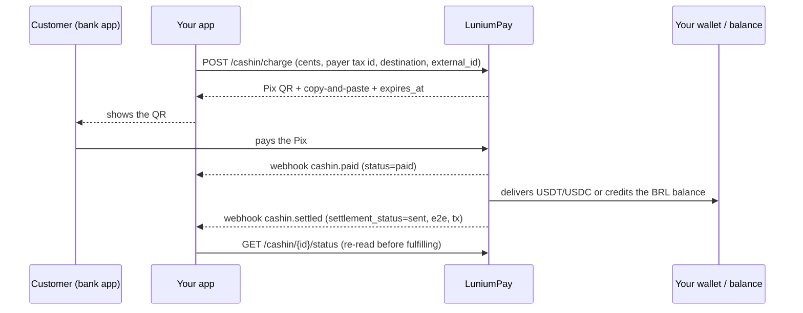

# Build with AI. Accept Pix. Settle in stablecoins.

**LuniumPay brings Brazilian Pix payments and USDT/USDC settlement to apps built with AI.**

Give your coding agent the official skills, choose your stack, and start in the sandbox.

[Start with Agent Skills](https://docs.luniumpay.com/skill) · [Read the docs](https://docs.luniumpay.com/) · [Explore examples](https://github.com/LuniumPay/lunium-examples) · [Português](#português)

<p>
  <a href="https://docs.luniumpay.com/openapi.json"></a>
  <a href="https://github.com/LuniumPay/lunium-agent-skills/releases"></a>
  <a href="https://registry.modelcontextprotocol.io/v0.1/servers?search=lunium"></a>
  <a href="https://github.com/LuniumPay/lunium-agent-skills/blob/main/LICENSE"></a>
</p>

## Start here

Install the official Agent Skills:

```bash
npx skills add LuniumPay/lunium-agent-skills
```

Then give your coding agent this prompt:

```text
Use the official LuniumPay skills to add Pix payments to my app.
Ask whether I want settlement to my USDT/USDC wallet or a BRL balance.
Inspect my stack and use the matching official recipe.
Start in the sandbox; keep API keys and webhook secrets on the server.
Render only the QR returned by the API, verify signed webhooks,
and recheck payment and settlement status before fulfilling an order.
Test a successful payment and a failure scenario. Show me the results
and the remaining production checklist before enabling real payments.
```

The skills are designed for tools that support [Agent Skills](https://agentskills.io/home), including Claude Code, Cursor, Codex and Gemini CLI. Installation equips the agent with integration guidance; your app still needs configuration and testing.

## Try it in 60 seconds (no account, no money)

```bash
# 1. sandbox key (the e-mail receives the manual once)
curl -s -X POST https://api.luniumpay.com/keys/sandbox -H 'Content-Type: application/json' -d '{"email":"you@company.com"}'
# → {"api_key":"lun_test_…"}   export LUNIUM_API_KEY=lun_test_…

# 2. a R$ 100.00 Pix charge settled in USDT to your wallet
curl -s -X POST https://api.luniumpay.com/cashin/charge -H "X-API-Key: $LUNIUM_API_KEY" -H 'Content-Type: application/json' \
  -d '{"amount_cents":10000,"payer_tax_number":"12345678909","destino":"cripto","asset":"USDT","chain":"polygon","payout_address":"0x000000000000000000000000000000000000dEaD","external_id":"order-1","sandbox_scenario":"success"}'
# → cashin_id, qr_image_url, qr_copypaste, expires_at

# 3. simulate the payment (sandbox only) and read the final state
curl -s -X POST https://api.luniumpay.com/sandbox/cashin/$CASHIN_ID/pay -H "X-API-Key: $LUNIUM_API_KEY" -H 'Content-Type: application/json' -d '{}'
curl -s https://api.luniumpay.com/cashin/$CASHIN_ID/status -H "X-API-Key: $LUNIUM_API_KEY"
# → status: paid · settlement_status: sent · usdt_amount · e2e · settlement_tx_hash
```

Production key in one call, no human approval, same contract: `POST https://api.luniumpay.com/keys` with `{"name":"Your company","email":"you@company.com"}`.

## How the money moves



Three independent fields in the status: `status` (the Pix), `settlement_status` (the delivery) and `settlement_proof` (the evidence). Fulfill with `paid` **and** `sent`.

## What you can build

- **Pix checkout:** let customers pay in BRL and settle to a USDT/USDC wallet or a BRL balance.
- **Payments from crypto:** integrate the documented crypto-to-Pix and USDT-wallet flows.
- **Track payment status:** use signed webhooks, payment verification and sandbox scenarios to handle success, failure and pending settlement.

## Pick your starting point

| Project | Start here when… |
| --- | --- |
| [lunium-agent-skills](https://github.com/LuniumPay/lunium-agent-skills) | You want your coding agent to guide the integration. Seven skills, framework recipes and sandbox scripts. |
| [lunium-examples](https://github.com/LuniumPay/lunium-examples) | You want to inspect examples in Node.js or Python, or explore requests with Postman. |
| [luniumpay](https://github.com/LuniumPay/luniumpay) | You want the developer portal and links to the API ecosystem. |

**Framework recipes:** Next.js · Express · FastAPI · Supabase Edge Functions

**Frontend:** a React checkout component is included in the skills repository.

## Test first, then prepare for production

Sandbox scripts use test credentials and do not move real funds. Keep credentials out of the browser and repository, handle repeated events safely, and verify the final status your product requires before fulfilling an order.

Fees, available routes, limits and timing come from the current API contract. A pending payment or settlement is not a completed delivery.

The live [documentation](https://docs.luniumpay.com/) and [integration guide](https://docs.luniumpay.com/skill) are the source of truth; examples and copied snippets can age.

## Talk to a human

Integration, volume and terms: **contato@luniumpay.com** · [WhatsApp](https://wa.me/27722944340) · official integrator community: [Lunium Partners on Telegram](https://t.me/+FerOZMRRP_g5MDk5).

## Building something with it?

Found a confusing step or a reproducible issue? Open an issue in the relevant repository and tell us your stack, expected behavior and what happened. Remove credentials and personal payment data first.

If the skills or examples help you build, a star helps other builders find them.

---

## Português

**Construa com IA. Receba Pix. Liquide em stablecoins.**

A LuniumPay conecta os apps que você cria com IA ao Pix brasileiro, com liquidação em USDT/USDC ou saldo em reais, além dos fluxos documentados de cripto para Pix.

Instale as skills com o comando acima e peça ao seu agente:

```text
Use as skills oficiais da LuniumPay para adicionar Pix ao meu app.
Identifique minha stack e pergunte se quero receber em carteira
USDT/USDC ou em saldo em reais. Comece no sandbox, mantenha chaves
e segredos no servidor e teste sucesso e falha. Valide o webhook
e consulte o estado final antes de liberar um pedido. Mostre os
resultados e o que falta antes de habilitar pagamentos reais.
```

Receitas para **Next.js, Express, FastAPI e Supabase Edge**, componente React de checkout, exemplos em **Node.js e Python** e coleção **Postman**.

[Comece pela skill](https://docs.luniumpay.com/skill) · [Documentação](https://docs.luniumpay.com/) · [Exemplos](https://github.com/LuniumPay/lunium-examples)

Fale com gente: **contato@luniumpay.com** · [WhatsApp](https://wa.me/27722944340) · [Lunium Partners no Telegram](https://t.me/+FerOZMRRP_g5MDk5).

Encontrou uma etapa confusa? Abra uma issue no projeto correspondente. Se ajudou você a construir, deixe uma estrela para outros criadores encontrarem.
